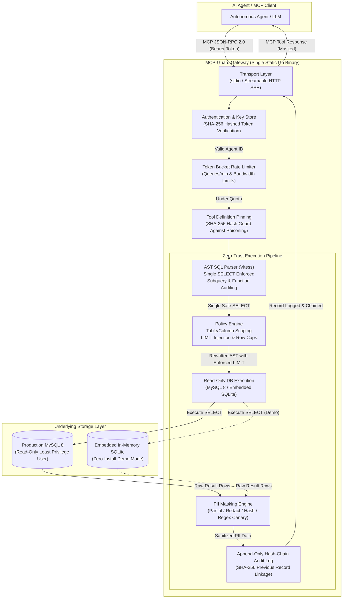

# Architecture & Security Pipeline: MCP-Guard

`mcp-guard` is a secure reverse-proxy gateway implementing the Model Context Protocol (MCP) to provide AI agents with policy-controlled, read-only database access.

## System Architecture Diagram

## Security Pipeline Stages

1. **Authentication:**
   The gateway inspects the incoming agent authorization credentials against pre-computed SHA-256 hashes in `agent_keys`. Unauthenticated requests or revoked agents are immediately terminated with JSON-RPC error `-32001`.

2. **Rate Limiting:**
   A per-agent token-bucket rate limiter enforces maximum queries per minute and result bandwidth limits to defend against data exfiltration and denial-of-service.

3. **Tool Definition Pinning:**
   At boot, `mcp-guard` computes a SHA-256 fingerprint of all registered tool schemas (`list_tables`, `describe_table`, `run_query`). Any runtime alteration or prototype pollution attempt triggers an immediate security alert.

4. **AST SQL Parser & Validator:**
   Using Vitess Abstract Syntax Tree (AST) parsing, the gateway ensures:
   - Exactly one statement is supplied (multi-query injection blocked).
   - The statement type is exclusively `SELECT` (all `INSERT`, `UPDATE`, `DELETE`, `DROP`, `ALTER`, `GRANT` rejected).
   - Dangerous server functions (`SLEEP`, `BENCHMARK`, `LOAD_FILE`, `INTO OUTFILE`) are rejected.
   - All referenced tables and columns are validated against the agent's policy.

5. **Policy Enforcement & Query Rewriting:**
   - Any query attempting to access forbidden tables or restricted columns is rejected.
   - For permitted queries without a `LIMIT` clause, the policy engine safely injects an AST `LIMIT` node conforming to `max_rows_per_query`.

6. **PII Masking:**
   Tabular results pass through the masking pipeline:
   - **Column Rules:** Columns designated for masking are transformed via `partial` (e.g. `a***e@example.corp`), `redact` (e.g. `[REDACTED_PHONE]`), or `hash` (SHA-256).
   - **Canary Pattern Detection:** Free-text columns are scanned for email addresses, phone numbers, and payment tokens.

7. **Tamper-Evident Hash-Chain Audit Logging:**
   Every query decision (allowed, denied, or masked) is appended to the audit log. Each record stores:
   $$\text{Hash}_n = \text{SHA256}(\text{Timestamp} \parallel \text{AgentID} \parallel \text{Tool} \parallel \text{Query} \parallel \text{Decision} \parallel \text{Hash}_{n-1})$$
   Any post-hoc alteration or deletion of audit logs breaks the cryptographic chain and is detected by `mcp-guard verify-audit`.
